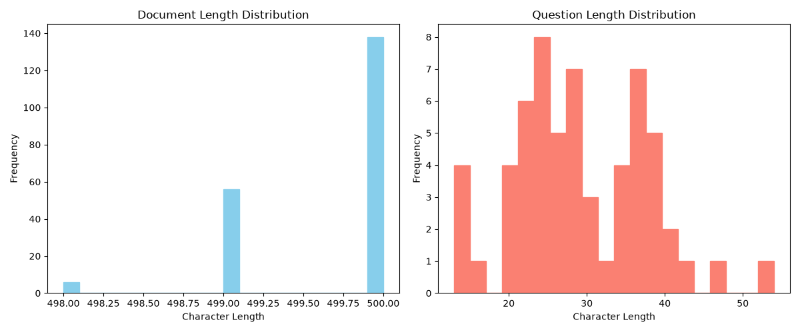

# 003. 데이터 분석 및 초기 가설

**프로젝트:** BERT 기반 한국어 의미 검색 시스템 개발 및 성능 비교 (NLP)  
**작성 범위:** CP-01

> Notebook에서 확인한 실제 값과 관찰을 기록합니다. 각 `___`를 실제 수치 또는 1~2문장으로 바꾸세요. 초기 가설은 CP-01에서 기록한 내용을 사용하며, 실험 결과를 본 뒤 수정하지 않습니다.

## 1. 검색 데이터셋 구조 (CP-01)

- **데이터 출처:** KLUE-MRC의 Validation 데이터에서 재구성한 교육용 검색 데이터
- **Corpus:** _200_개 문단
- **Validation / 보류 Test:** 질문 _60_개 / _20_개
- **질문과 정답 문서의 연결 기준(`relevant_doc_id`):** _query_id, doc_id_
- **Validation과 Test가 동일한 Corpus를 사용하는 의미:** ___
> Validation과 Test가 동일한 Corpus를 사용한다는 것은 두 단계에서 검색할 문서 모음은 같고, 질문과 정답 문서만 서로 다른 데이터 분할에 속한다는 뜻입니다.
> - Validation은 검색 방법이나 하이퍼파라미터를 선택하는 데 사용합니다.
> - Test는 선택을 마친 방법의 최종 성능을 평가하는 데 사용합니다.

> 같은 문서 집합을 쓰면 실제 배포처럼 고정된 코퍼스에서 새 질문을 검색하는 상황을 평가할 수 있습니다. 다만 Test 결과를 보고 설정을 다시 조정하면 Test가 검증에 사용된 셈이 되어, 최종 성능 평가가 공정하지 않게 됩니다.

아래 분석에서는 Corpus와 Validation 질문만 사용합니다. 보류 Test 질문은 CP-10에서 평가합니다.

## 2. 문서·질문 길이 분석 (CP-01)

`corpus_stats['char_length']`와 `valid_stats['char_length']`의 통계 및 히스토그램을 참고합니다. 단위는 토큰 수가 아닌 글자 수입니다.

| 구분 | 평균 | 중앙값 | 최소 | 최대 |
|---|---:|---:|---:|---:|
| Corpus 문서 | _499.66__ | _500.00__ | _498.00__ | _500.00__ |
| Validation 질문 | _60.00__ | _28.00__ | _13.00__ | _54.00__ |

**분석:** 문서와 질문의 길이 분포에서 관찰한 특징과 그 특징이 검색에 영향을 줄 가능성을 작성합니다.  
___

> 참고 결과: `outputs/figures/cp01_length_distribution.png`

## 3. 질문–정답 문단의 문자 겹침 비율 (CP-01)

`valid_overlap`은 질문의 어절 내부 고유 문자 2-gram 중 정답 문단에도 등장하는 비율입니다. TF-IDF 유사도 점수와는 다릅니다.

- **Validation 전체 겹침 비율의 평균 / 중앙값:** _0.474__ / _0.462__
- **겹침 비율의 최소 / 최대:** _0.158__ / _0.882__
- **겹침 비율이 낮은 대표 질문 1개(ID / 질문 / 겹침 비율):** 
QV018 / 소위 천의 여왕으로 불리는 인물이 대륙에 발표한 방책은 무엇인가? / 0.158
- **해당 정답 문단에서 확인한 표현 차이:** ___

**분석:** 겹침 비율 분포에서 발견한 특징을 작성합니다.  
___질문의 어절 내부 글자 2-gram이 정답 문단에도 나타나는 비율은 60개 질문에서 평균 0.474, 중앙값 0.462였다. 즉, 평균적으로 질문의 글자 2-gram 중 약 절반이 정답 문단에 포함되어 있었다. 다만 비율은 0.158~0.882로 편차가 컸고, 가운데 50%도 0.333~0.601 범위에 분포했다. 따라서 질문에 따라 정답 문단과의 표면적 문자열 겹침 정도가 상당히 다르며, 겹침이 낮은 질문은 단어 일치에 의존하는 검색이 어려울 수 있다.

> 참고 결과: `outputs/tables/cp01_validation_overlap.csv`
[겹침 결과 CSV](../outputs/tables/cp01_validation_overlap.csv)

## 4. 검색 성능에 대한 초기 가설 (CP-01)

- **가설 ① TF-IDF가 유리할 것으로 예상하는 질문 유형과 이유:** ___
정답 문단과 글자 2-gram 겹침 비율이 높은 질문에서 TF-IDF 검색이 잘 작동할 것으로 예상한다. TF-IDF는 질문과 문서에 공통으로 등장하는 단어를 바탕으로 유사도를 계산하므로, 질문의 핵심 표현이나 고유명사가 정답 문단에도 나타나면 해당 문단의 점수가 높아질 수 있다. 반대로 겹침 비율이 낮은 질문은 정답 문단이 다른 표현을 사용했을 가능성이 있어 찾기 어려울 수 있다.

- **가설 ② BERT 기반 검색이 유리하거나 불리할 것으로 예상하는 질문 유형과 이유:** ___
정답 문단과 글자 2-gram 겹침은 낮아도 질문과 문단이 의미상 비슷한 표현을 사용하는 경우, 문맥을 반영하는 BERT 기반 검색이 유리할 것으로 예상한다. 다만 BERT 임베딩 검색은 질문과 문단의 의미가 비슷한지를 찾는 방식이므로, 인물·사건의 정확한 관계나 부정 표현처럼 세부 조건이 중요한 질문에서는 주제만 비슷한 문단을 잘못 찾을 수 있다. 따라서 겹침 비율이 낮은 질문에서 BERT가 TF-IDF보다 항상 우수하다고 단정하기보다는, 두 검색 결과의 정답 문단 포함 여부를 비교해 확인해야 한다.

> 이 가설을 실제 검색 결과와 비교한 내용은 `02_nlp_model_analysis.md`의 4절에 작성합니다.
